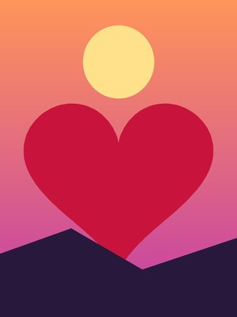
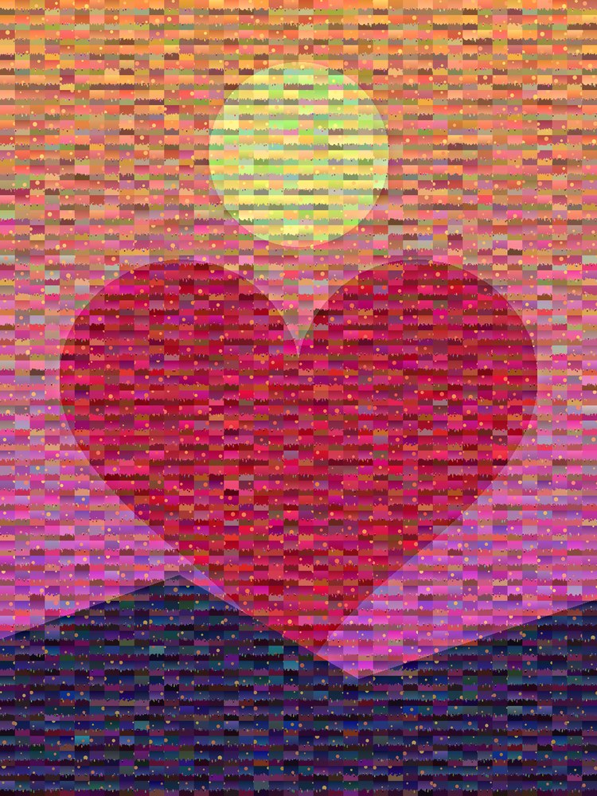
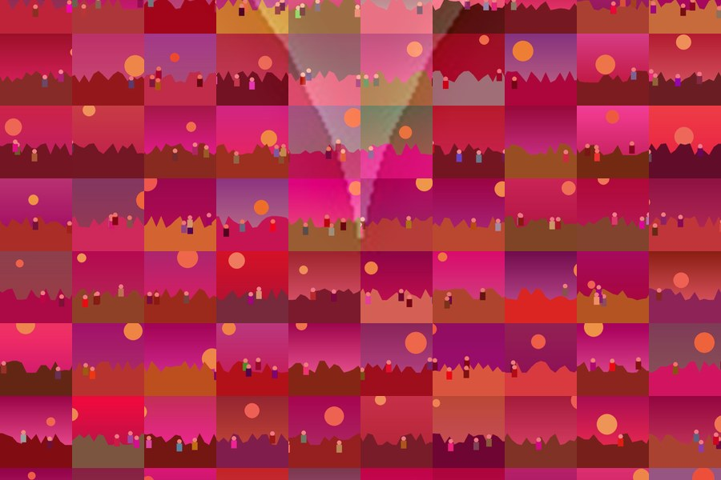

# photomosaic-poster

Turn one photo plus a folder of hundreds (or thousands) of photos into a **print-ready
photo mosaic poster**. Up close you see every little photo; from across the room you
see the big picture.

Made for birthday and graduation posters, where friends send in their photos, and
built to survive the real world. It handles phone photos (HEIC, EXIF rotation, every
size), duplicate uploads and burst shots, print shops with file-size limits, CMYK
requirements and wide-format plotters.

| Target picture | Poster (600 photos) | Close up |
|---|---|---|
|  |  |  |

*The demo is built from generated images. Run `python examples/make_demo.py` to make
it yourself.*

## Install

Requires Python 3.9 or newer.

```bash
pip install git+https://github.com/OWNER/photomosaic-poster.git
```

Or from a clone:

```bash
git clone https://github.com/OWNER/photomosaic-poster.git
cd photomosaic-poster
pip install -e .
```

## Quick start

```bash
mosaic-poster birthday_person.jpg friends_photos/ -o poster.png
```

That makes a 24×36 inch poster at 150 DPI. It picks the number of tiles from how many
photos you have, keeps any one photo from appearing too often or next to itself, and
makes sure every distinct photo appears at least once, so everyone can find theirs.

You can pass several photo folders, and they're searched recursively:

```bash
mosaic-poster target.jpg drive_download/ icloud_part1/ icloud_part2/ -o poster.png
```

## Recipes

**Choose the size and tile count:**
```bash
mosaic-poster target.jpg photos/ -o poster.png --size 36x24 --cols 70
```

**A dark or badly framed target photo.** Crop it, then brighten it:
```bash
mosaic-poster target.jpg photos/ -o poster.png --crop 0.1,0.15,0.9,0.75 --gamma 0.7 \
    --save-target check_crop.png
```

**A clearer face, or more visible photos:**
```bash
--tint 0.6 --overlay 0.4    # face reads from across the room
--tint 0.3 --overlay 0.2    # the little photos stay more natural
```

**Add a banner:**
```bash
--text "HAPPY BIRTHDAY SAM" --text-height 3
```

**A print shop that wants CMYK, 300 DPI and files under 75 MB:**
```bash
mosaic-poster target.jpg photos/ -o poster.pdf --size 36x54 --dpi 300 --cmyk --max-mb 74
```

**A wide-format bond-paper plotter** (uncoated paper prints dark and flat):
```bash
--brightness 1.05 --contrast 1.1 --saturation 1.15
```

**A printer that chokes on one huge file.** Split it into panels with some overlap:
```bash
--panels 2 --overlap 0.5
```

See **[docs/printing.md](docs/printing.md)** for the full printing guide and
troubleshooting, and **[docs/collecting-photos.md](docs/collecting-photos.md)** for
gathering photos from friends.

## How many photos do I need?

Each photo can repeat, but repeats get noticeable above about 4–5 uses. Rough guide for
tiles about half an inch across:

| Poster | Tiles | Minimum photos | Good | Great |
|---|---|---|---|---|
| 18×24 | ~1,700 | 250 | 500 | 900 |
| 24×36 | ~3,500 | 450 | 900 | 1,800 |
| 36×54 | ~7,800 | 1,000 | 2,000 | 3,900 |

With `--cols 0`, the default, the tool picks the column count for you. It aims for
about 0.5 inch tiles, but uses fewer, bigger tiles if you don't have enough photos.

## How it works

1. **Target:** the target photo is cropped to the poster shape and averaged into a grid
   of cells.
2. **Photos:** every photo is decoded upright, center-cropped to a square and cached,
   so re-renders with different settings take seconds. Exact duplicates are dropped,
   and look-alike shots, such as bursts and retakes, are grouped with a perceptual hash.
3. **Matching:** each cell gets a photo with a similar average color, compared in
   CIE Lab color space. Three rules keep it varied:
   - a cap on how often any photo appears;
   - no photo, or look-alike of it, within `--spacing` tiles of itself;
   - a random pick among the near-best matches, so flat areas like sky don't fill up
     with the same few pictures.

   Then every distinct photo is guaranteed a spot.
4. **Tint:** each tile's colors are shifted part of the way (`--tint`) toward its cell's
   color, keeping the photo's detail.
5. **Overlay:** a faint, sharpened copy of the target (`--overlay`) is blended on top to
   restore fine features, like eyes, that a coarse grid can't carry.
6. **Output:** the poster is built in strips, so even a 175-megapixel print fits in
   memory. It is written as PNG, JPEG, PDF or TIFF in RGB or CMYK, with the correct DPI,
   at the highest JPEG quality that fits any size limit you set.

Run `mosaic-poster --help` for every option.

## Use it from Python

```python
from mosaic_poster import PosterOptions, make_poster

make_poster(PosterOptions(target="target.jpg", tile_dirs=["photos"],
                          output="poster.png", width_in=24, height_in=36, dpi=150))
```

## Privacy

Everything runs on your computer and nothing is uploaded. The `.gitignore` keeps
photos, caches and posters out of git, in case you work inside a clone.

## License

MIT
